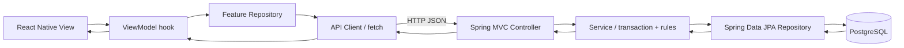

# System Architecture — Week 3

Đây là sơ đồ luồng request, không phải ERD. ERD mô tả bảng và FK; sơ đồ dưới đây mô tả tầng phần mềm.

## Ánh xạ source thực tế

- Frontend Vocabulary: `src/screens/vocabulary-screen.tsx` (View) → `src/features/vocabulary/hooks/use-decks-view-model.ts` → `deck-repository.ts` → `src/services/api-client.ts` → `GET /api/v1/decks`.
- Backend: `DeckController` → `DeckService` → `DeckRepository` → bảng `decks`. DTO `DeckResponse` ngăn trả Entity trực tiếp.
- Profile demo: `ProfileDevController` → `ProfileService` → `UserRepository`/`UserProfileRepository` → `users`/`user_profiles`.
- `@Transactional` nằm ở Service. Controller lo HTTP/status/DTO; Repository lo truy cập dữ liệu; schema giữ FK/CHECK/trigger.

## Công nghệ và lựa chọn

- PostgreSQL là nguồn dữ liệu tập trung, hỗ trợ FK/transaction/constraint/trigger cho lịch sử Quiz, FSRS và hội thoại.
- React Native không kết nối thẳng PostgreSQL: không đặt DB credential trong ứng dụng mobile, tránh đưa SQL và quyền DB ra thiết bị; REST API là điểm kiểm soát validation và nghiệp vụ.
- SQLite/Room hợp với lưu trữ offline trên thiết bị, nhưng không thay nguồn dữ liệu dùng chung cho nhiều người. Có thể thêm cache/offline sync sau MVP.
- Firebase/Firestore có thể tăng tốc realtime/prototype, nhưng quan hệ ghép, FK, deferred constraints và truy vấn quan hệ trong schema này phù hợp PostgreSQL hơn; đổi sang document DB cần thiết kế lại các quy tắc.
- Service tách quy tắc khỏi HTTP; Repository tách persistence. Không phải mọi logic cần ở DB: constraints bảo vệ tính toàn vẹn ở mọi client, Service xử lý use case; UI không tự quyết định dữ liệu chuẩn.

## Giới hạn hiện tại

API thật hiện có Health, Deck và Profile demo. Chỉ Deck GET được nối vào Vocabulary mobile. Không có API Quiz/FSRS/IPA/Conversation hoàn chỉnh. Chưa có Authentication/RBAC. API `/dev` chỉ được đăng ký profile `local`; không bật profile này khi bind ra LAN/production.
