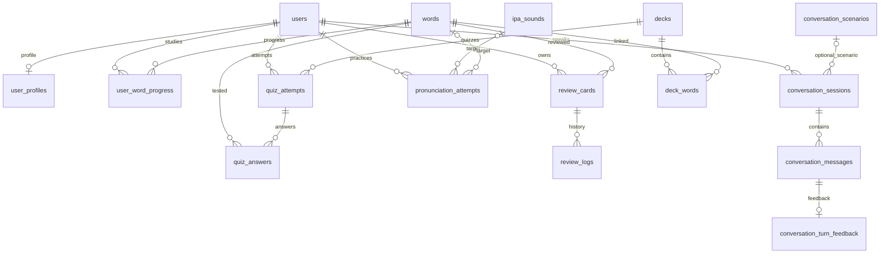

# ERD tổng quan — Week 3

ERD DBML đầy đủ 16 bảng/19 FK ở [ERD_OVERVIEW.dbml](./ERD_OVERVIEW.dbml), được sao từ `database/week3/English_Learning_ERD.dbml`; đối chiếu cột, FK và ON DELETE trực tiếp với `database/week3/schema.sql`. Mở DBML tại dbdiagram.io để xem toàn sơ đồ. DBML mô tả bảng/quan hệ; các CHECK, trigger và quy tắc lịch sử phải trình bày theo SQL vì DBML hiện không biểu diễn hết các quy tắc này.

## Góc nhìn theo nghiệp vụ

`deck_words` là bảng nối N–N; PK ghép `(deck_id, word_id)`. `review_cards` có PK ghép `(user_id, word_id)` và `review_logs` tham chiếu lại đúng cặp đó bằng FK ghép. `conversation_turn_feedback.message_id` vừa NOT NULL vừa UNIQUE nên mỗi message có nhiều nhất một feedback. Ký hiệu Mermaid thể hiện bội số nghiệp vụ; xem SQL để phân biệt FK nullable và CHECK.

## Sáu nhóm

1. Users/Profile: `users`, `user_profiles`.
2. Vocabulary: `decks`, `words`, `deck_words`, `user_word_progress`.
3. Quiz: `quiz_attempts`, `quiz_answers`.
4. FSRS: `review_cards`, `review_logs`.
5. IPA: `ipa_sounds`, `pronunciation_attempts`.
6. AI Conversation: `conversation_scenarios`, `conversation_sessions`, `conversation_messages`, `conversation_turn_feedback`.
